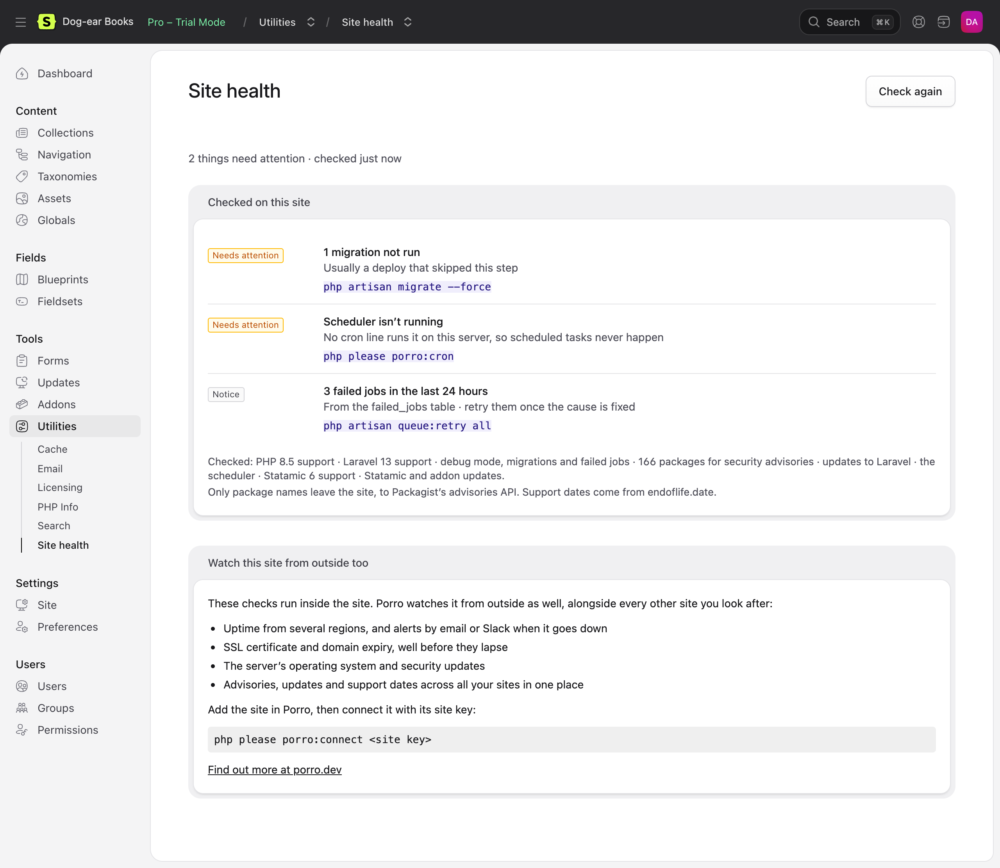
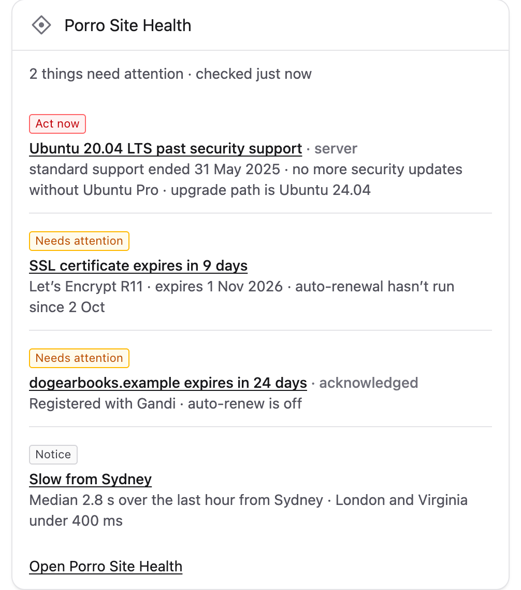
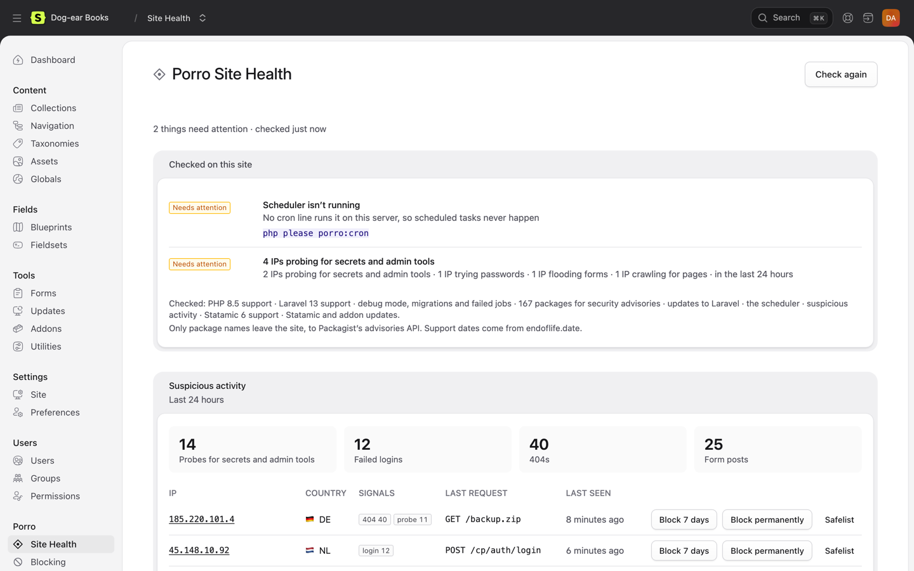
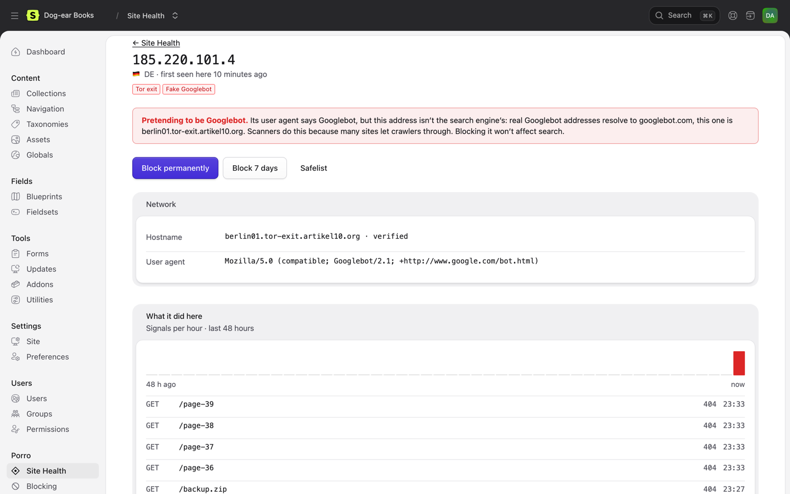
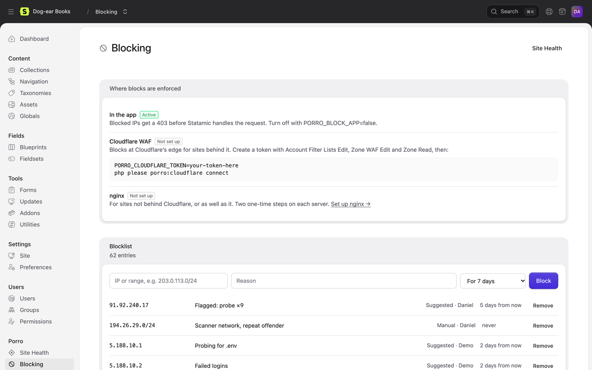
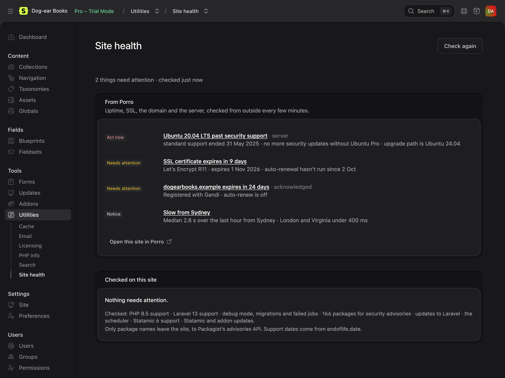

# Porro Site Health for Statamic

Site health for Statamic 5 and 6, inside the control panel. It checks the site for the things that quietly go wrong between projects (security advisories in your Composer packages, PHP, Laravel and Statamic versions running out of security support, updates waiting, a scheduler that never runs) and tells you what to do about each.

It's free and works on its own. If you use [Porro](https://porro.dev/?utm_source=statamic-connector&utm_medium=readme&utm_campaign=connectors) to look after your sites, connecting it adds what can only be seen from outside: uptime, SSL certificates, domain expiry and the server's operating system.



## Install

```bash
composer require porro/statamic-connector
```

Then run `php please migrate` (it adds the blocklist and activity tables) and open **Porro → Site Health** in the control panel.

### Dashboard widget

Add it to `config/statamic/cp.php`:

```php
'widgets' => [
    ['type' => 'porro_site_health', 'width' => 50],
],
```

It lists the five most important issues (`'limit' => 5` to change that) and links to Site Health. It shows the last result rather than running the checks, so the dashboard never waits on them.



### Who can see it

Super admins. For other roles, under **Porro** in **Users → Roles**:

- **View Porro Site Health** shows both pages, the widget and the "Check again" button.
- **Block and safelist IP addresses** adds the block, unblock and safelist buttons.

Upgrading from 0.2? The old **Access Porro Site Health utility** permission isn't used any more. Give those roles **View Porro Site Health** instead.

## What it checks

On the site itself, with no account:

| Check | How |
|---|---|
| Security advisories in `composer.lock` | [Packagist's security advisories API](https://packagist.org/apidoc#list-security-advisories), the one `composer audit` uses. Only package names are sent; versions are matched on your server. High and critical advisories show as **Act now**. |
| PHP, Laravel and Statamic support | Past, or within 90 days of, the end of security support, from [endoflife.date](https://endoflife.date). A copy ships with the addon for when it can't be reached. |
| Updates | Statamic and addon updates from Statamic's own updater (flagged when one is a security release), and newer Laravel releases on the major version you run |
| Scheduler | Whether `schedule:run` is running, from a heartbeat the addon schedules every 15 minutes, and whether the crontab has the line. `php please porro:cron` adds it. |
| Debug mode, migrations, failed jobs | `APP_DEBUG` on in production, migrations not run, failed jobs in the last 24 hours |
| Backups and health checks | Stale backups from `spatie/laravel-backup` and failing `spatie/laravel-health` checks, if you use them |

Results are cached for five minutes, and the public data behind them for between six hours and a day, so the page is quick and the APIs aren't asked often. **Check again** runs everything now.

## Suspicious activity and blocking

Also free and on the site itself. IP addresses aren't sent to Porro, and only leave the server in the cases listed under [Where IP addresses go](https://github.com/Porrodev/laravel-connector#where-ip-addresses-go): Cloudflare and reverse-DNS lookups on an IP's details page, the AbuseIPDB button, and blocking at Cloudflare. The rules are the [Laravel connector's](https://github.com/Porrodev/laravel-connector#suspicious-activity-and-blocking), so its README has every setting.



- **What's watched:** probes for files like `/.env`, `/.git` and `wp-login.php`, failed logins (from Laravel's `Failed` auth event, which the control panel's login fires; token guards and custom guards that don't fire it aren't counted), bursts of 404s and form floods. Counts are kept for 48 hours in Porro's own `porro_cache` table, so a deploy's cache clear doesn't wipe them, and usernames only as hashes.
- **Suspicious requests are batched:** each one appends a line to `storage/porro/activity.buf` on its server, and the lines are recorded every minute by the scheduler, now and then at the end of a suspicious request, and whenever an activity page opens. Flags can lag by up to a minute; blocking is immediate. Where storage can't be written, or on Lambda (Vapor), each request is recorded straight away. `PORRO_ACTIVITY_BUFFER=false` turns batching off.
- **Site Health lists the IPs worth a look,** worst first, with badges for Tor exits, Spamhaus DROP, hosting networks and research scanners, and **Block 7 days**, **Block permanently** and **Safelist** buttons. Each one asks first, in a confirmation that says what will happen and for how long.
- **Exposed files:** if `/.env` or `/.git` ever answers, that's raised as **Act now**.
- **IP details:** click an IP for its network (from Cloudflare's API when `PORRO_CLOUDFLARE_TOKEN` is set, which sends Cloudflare the IP), a reverse-DNS hostname checked both ways, what it did here over 48 hours, and a plain note when something claiming to be Googlebot or Bingbot isn't. With `PORRO_ABUSEIPDB_KEY`, a button checks AbuseIPDB; it sends the IP to AbuseIPDB, so it only runs when clicked.



- **The Blocking page:** where blocks are enforced, the newest of the blocklist and safelist (each searchable on its own page, 50 at a time), and what's always protected.
- **Where blocks are enforced:**
  - **In the app:** blocked IPs get a plain 403 before Statamic runs. On by default; `PORRO_BLOCK_APP=false` turns it off.
  - **At Cloudflare's edge:** open **Porro → Blocking → Set up Cloudflare** and follow three steps. Create a token with Zone WAF Rules: Edit and Zone: Read on the site's domain, plus Account Rule Lists: Edit on the account. Set it as `PORRO_CLOUDFLARE_TOKEN`, then press Connect (or run `php please porro:cloudflare connect`). It adds one rule next to your existing ones, and only production syncs. Blocked IPs and ranges go into the account's `porro_blocklist` list with their notes. The list belongs to the whole Cloudflare account, so every site you connect on that account shares its blocks.
  - **In nginx:** `PORRO_BLOCK_NGINX=true`, then **Blocking → Set up nginx** walks through three steps with this site's real paths and shows how far each server has got.
- **Always protected:** Cloudflare, Laravel Forge and its health checks, Google's and Bing's published crawler ranges, and private addresses: a block that covers any of them is refused when you try to add it, and the app never turns them away. Open each on the Blocking page to see its ranges and why. Not on Forge? `PORRO_PROTECT_FORGE=false`. Happy to block a crawler? `PORRO_PROTECT_CRAWLERS=false`. Blocks of your own IP or very wide ranges are refused too.



- **Production only:** activity is recorded in production only (`PORRO_ACTIVITY=true` to record elsewhere). Blocks apply everywhere.
- **Static caching:** pages served from Statamic's static cache never reach the app, so traffic counts run low. Probes and logins aren't served from the static cache, so they're still caught.
- **Country:** comes from Cloudflare when the site is behind it. Otherwise it comes from [DB-IP](https://db-ip.com)'s free country file, downloaded monthly to `storage/porro`.

## Connect Porro (optional)

Porro watches every site you look after from outside: uptime from several regions, SSL and domain expiry, the server's OS and security updates, with alerts by email or Slack. It's a separate service with its own account; see [porro.dev](https://porro.dev/?utm_source=statamic-connector&utm_medium=readme&utm_campaign=connectors) for plans. Nothing in this addon needs it, and nothing is sent to Porro until you connect. Add the site in Porro, then:

```bash
php please porro:connect <site key>
```

Site Health then shows the site's open findings in Porro alongside the checks above, each linking to Porro.



Connecting also sends Porro a signed report every 15 minutes on Laravel's scheduler: versions, packages and the health facts above, never content, users or settings values. Run `php artisan porro:status --json` to see exactly what would be sent, and see the [Laravel connector](https://github.com/Porrodev/laravel-connector) for config and commands.

`php please porro:connect` offers to add the scheduler's cron line; `php please porro:cron` adds it on its own.

## Requirements

- Statamic 5 or 6, Laravel 11–13, PHP 8.2+
- Outbound HTTPS to `packagist.org`, `repo.packagist.org` and `endoflife.date` (and `app.porro.dev` once connected). Without it, the checks that need them say so and the rest still run.

## External requests

| To | When | What's sent |
|---|---|---|
| `packagist.org` | Advisory check, at most every 6 hours or when `composer.lock` changes | Package names from `composer.lock` |
| `repo.packagist.org` | Laravel update check, at most twice a day | Nothing beyond the request |
| `endoflife.date` | Support dates, at most once a day | Nothing beyond the request |
| `app.porro.dev` | Only once connected: reports every 15 minutes, findings when Site Health is open (cached 5 minutes) | Signed with the site key |
| `www.cloudflare.com`, `forge.laravel.com` | Their published IP ranges, once a day | Nothing beyond the request |
| `developers.google.com`, `www.bing.com` | Google's and Bing's published crawler ranges, once a day | Nothing beyond the request |
| `check.torproject.org`, `www.spamhaus.org` | The Tor exit and Spamhaus DROP lists, when an IP's details page opens (cached an hour and a day) | Nothing beyond the request |
| `api.cloudflare.com` | Only with `PORRO_CLOUDFLARE_TOKEN`: syncing blocks, and opening an IP's details page (cached a day per IP) | Blocked IPs and ranges with their notes, and the IP being looked at |
| `api.abuseipdb.com` | Only with `PORRO_ABUSEIPDB_KEY`, when someone clicks the reputation button | The IP being checked |
| `download.db-ip.com` | The free country file, once a month, where activity is recorded | Nothing beyond the request |

## Support

Questions and bugs: [GitHub issues](https://github.com/Porrodev/statamic-connector/issues). Security issues: please email security@porro.dev rather than opening an issue. We reply within one working day.

## Demo

[Dog-ear Books](https://github.com/Porrodev/statamic-demo) is a demo site with the addon set up and things for it to find, a stand-in Porro for the connected view, and the end-to-end checks and screenshot script behind these images.

## Developing

```bash
composer install
composer test
```

## License

MIT. See [CHANGELOG.md](CHANGELOG.md) for what changed.
